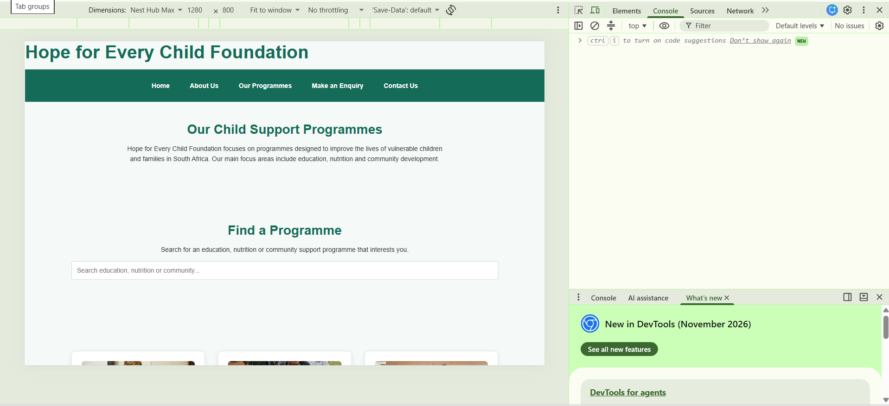
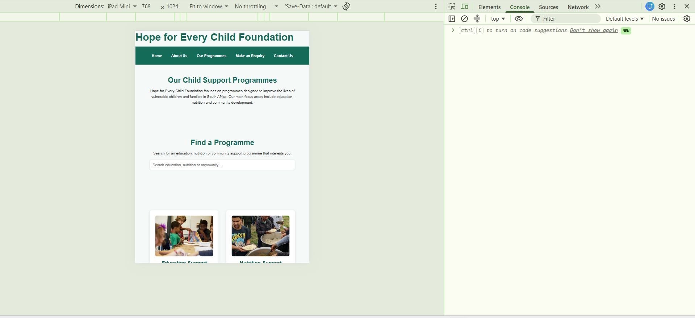
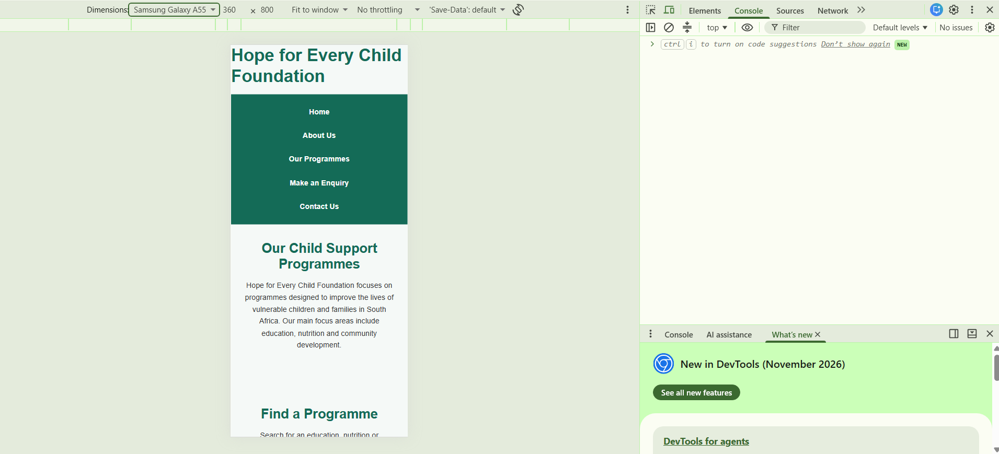

# Hope for Every Child Foundation Website

## Student Information

- **Full Name:** Lufuno Tshivhase
- **Student Number:** ST10456188
- **Subject:** Web Development
- **Project:** Parts 1, 2 and 3 – Website Development

---

## 1. Project Overview

The Hope for Every Child Foundation website is a small non-profit organisation website designed to provide information about the organisation, its programmes and the different ways members of the public can get involved.

The website aims to provide a simple, professional and user-friendly online presence. Visitors can learn about the Foundation, explore its programmes, submit enquiries and access contact information.

The website was developed using HTML5, CSS3 and JavaScript. It also incorporates responsive design, interactive functionality and Search Engine Optimisation (SEO) techniques.

---

## 2. Website Goals and Objectives

The main goals of the website are:

- To provide information about Hope for Every Child Foundation.
- To explain the organisation's mission, vision and values.
- To provide information about the Foundation's programmes.
- To encourage visitors to volunteer and support the organisation.
- To allow visitors to submit enquiries through online forms.
- To provide contact information and organisational locations.
- To create a professional and accessible online presence.
- To provide a responsive website that works across different devices.

### Key Performance Indicators (KPIs)

The success of the website can be measured using the following indicators:

- Number of website visitors.
- Number of enquiries received.
- Number of volunteer enquiries.
- Number of sponsorship enquiries.
- Number of partnership enquiries.
- Time visitors spend on the website.
- Number of visitors who navigate to the programmes and enquiry pages.

---

## 3. Website Pages and Features

The website consists of five main pages.

### 3.1 Home Page

The Home page introduces Hope for Every Child Foundation and provides information about the organisation's focus areas. It includes a hero section, images, calls to action, programme highlights and an image gallery.

An interactive image gallery allows visitors to select images and view them in a larger lightbox display.

### 3.2 About Us Page

The About Us page provides information about the organisation's mission, vision, values and the communities it supports.

An interactive FAQ accordion allows visitors to expand and read answers to frequently asked questions.

### 3.3 Programmes Page

The Programmes page provides information about:

- Education Support
- Nutrition Support
- Community Development

The page includes programme images, descriptions and calls to action.

A JavaScript search function allows visitors to search for programmes by entering keywords. The displayed programme cards are filtered according to the search term.

### 3.4 Get Involved / Enquiry Page

The Enquiry page allows visitors to submit enquiries relating to:

- Volunteering
- Sponsorship
- Programme information
- General enquiries

The form uses HTML5 and JavaScript validation. After a valid submission, a relevant confirmation message is displayed based on the type of enquiry.

### 3.5 Contact Page

The Contact page provides:

- Two organisational locations.
- Telephone information.
- Email information.
- Office hours.
- A contact form.
- An interactive map using Leaflet.

The contact form validates the visitor's information and prepares an email containing the submitted details using the visitor's default email application.

---

## 4. Technologies and Tools Used

The following technologies and tools were used:

- HTML5
- CSS3
- JavaScript
- Leaflet JavaScript library
- Visual Studio Code
- Google Chrome Developer Tools
- GitHub
- Unsplash images

---

## 5. Project File Structure

The website uses the following file and folder structure:

```text
HOPE-FOR-EVERY-CHILD
│
├── css
│   └── style.css
│
├── images
│   ├── hero.jpg
│   ├── education.jpg
│   ├── nutrition.jpg
│   └── Volunteers.jpg
│
├── screenshots
│   ├── desktop.png
│   ├── mobile.png
│   └── tablet.png
│
├── index.html
├── about.html
├── programmes.html
├── enquiry.html
├── contact.html
├── script.js
├── robots.txt
├── sitemap.xml
└── README.md
```

---

# Part 2 – CSS Styling and Responsive Design

## 6. CSS Styling

The website uses an external CSS stylesheet named `style.css`, located inside the `css` folder.

The stylesheet provides:

- A consistent colour scheme and typography.
- A CSS reset for consistent browser rendering.
- Responsive spacing and image styling.
- Flexbox for the navigation layout.
- CSS Grid for programme cards.
- Styled buttons, forms, cards and page sections.
- Hover, focus and active states.
- Consistent headings, paragraphs and page structure.

The external stylesheet is linked to all five HTML pages.

## 7. Responsive Design

The website was designed to work across desktop, tablet and mobile screen sizes.

The following breakpoints were used:

- **Desktop:** More than 900px.
- **Tablet:** 601px–900px.
- **Mobile:** 600px and below.

On larger screens, programme cards are displayed in multiple columns. On smaller screens, the cards adjust to fewer columns and eventually one column.

The navigation also adjusts to a vertical layout on smaller screens. Images use flexible widths to prevent content from overflowing the page.

## 8. Responsive Testing

The website was tested using Google Chrome Developer Tools.

The following screen sizes were tested:

| Device | Screen size | Result |
|---|---|---|
| Desktop | 1440 × 900 | Passed |
| Tablet | 768 × 1024 | Passed |
| Mobile | 390 × 844 | Passed |

The tests confirmed that the navigation, programme cards, images, gallery and page content adjust correctly to different screen sizes.

The website was also checked for horizontal scrolling and overlapping content.

## 9. Part 2 Changes

The following improvements were implemented:

- Created and applied the external CSS stylesheet.
- Added CSS reset and consistent base styling.
- Added typography, spacing and colour styling.
- Added Flexbox navigation and CSS Grid programme cards.
- Added responsive layouts for desktop, tablet and mobile screens.
- Added responsive image styling.
- Added hover, focus and active states.
- Tested all five website pages.
- Tested navigation links and forms.
- Captured desktop, tablet and mobile responsive testing screenshots.

### Responsive Design Evidence

#### Desktop Testing



#### Tablet Testing



#### Mobile Testing



---

# Part 3 – Enhancing Functionality and SEO

## 10. Corrections and Improvements Based on Part 2 Feedback

The Part 2 feedback indicated that the CSS stylesheet was not correctly implemented on every web page and that the website appeared to run mainly as HTML.

To address this feedback, the website was reviewed and updated.

The following corrections were made:

- Checked the stylesheet link on all five HTML pages.
- Corrected the stylesheet path to `css/style.css`.
- Ensured that all five pages use the external stylesheet.
- Reviewed the website layout and styling for consistency.
- Checked the navigation, buttons, cards, forms and page sections.
- Tested the pages again on desktop, tablet and mobile screens.
- Confirmed that the website displays its styling and responsive layouts correctly.

## 11. JavaScript Enhancements

JavaScript was used to improve the website's interactivity and user experience.

### 11.1 Interactive Image Gallery and Lightbox

An image gallery was added to the Home page.

Visitors can:

- Select an image to view it in a larger display.
- Close the image using the close button.
- Close the lightbox by clicking outside the image.
- Close the lightbox using the Escape key.

### 11.2 FAQ Accordion

An interactive FAQ accordion was added to the About Us page.

Visitors can select a question to reveal its answer. Selecting the question again hides the answer.

The accordion also uses the `aria-expanded` attribute to communicate its expanded or collapsed state.

### 11.3 Programme Search Functionality

A search function was added to the Programmes page.

JavaScript checks the programme content and filters the programme cards according to the visitor's search term.

This allows visitors to find relevant programmes more easily.

### 11.4 Interactive Map

An interactive map was implemented on the Contact page using the Leaflet JavaScript library.

The map displays markers for the Pretoria and Johannesburg locations. Visitors can interact with the markers to view location information.

### 11.5 Form Validation and Responses

JavaScript validation was added to the enquiry and contact forms.

The forms use HTML5 validation and JavaScript to check the information entered by visitors.

The enquiry form displays a confirmation message relevant to the selected enquiry type.

The contact form prepares an email containing the visitor's contact details and message using a `mailto` link.

**Note:** The forms currently use client-side functionality. They do not store submissions in a database or automatically send messages to a server. The contact form requires the visitor to use an email application to send the prepared email.

## 12. Search Engine Optimisation (SEO)

SEO improvements were implemented to help search engines understand the website content.

### 12.1 On-Page SEO

The following SEO techniques were applied:

- Added descriptive page titles.
- Added meta descriptions to the HTML pages.
- Added relevant keywords.
- Used appropriate heading structures.
- Added descriptive alternative text to images.
- Used meaningful page content and headings.
- Added internal links between the website pages.
- Ensured that the website is responsive on mobile devices.
- Used descriptive page names such as `programmes.html` and `contact.html`.

### 12.2 Image Optimisation

Images were given descriptive alternative text to improve accessibility and help search engines understand their content.

Image loading was also improved using lazy loading where appropriate.

### 12.3 Off-Page SEO

Off-page SEO focuses on improving the website's visibility through external websites and online platforms.

Possible future improvements include:

- Creating social media pages for the organisation.
- Sharing website links on relevant social media platforms.
- Building backlinks through relevant community organisations and non-profit directories.
- Encouraging partner organisations to link to the Foundation's website.

These activities are recommendations for future implementation and are not claimed as completed.

### 12.4 Local SEO

The website includes Pretoria and Johannesburg location information.

The contact page provides organisational contact details and an interactive map to help visitors identify the locations.

### 12.5 Robots.txt and Sitemap.xml

Two SEO-related files were added to the project root:

- `robots.txt` provides instructions to search engine crawlers.
- `sitemap.xml` lists the website's main pages to help search engines discover the content.

The placeholder website domain in these files must be replaced with the actual deployed website address before submission and indexing.

## 13. Website Performance and Security

The following practices were considered to improve website performance and security:

- Responsive CSS layouts.
- Appropriate image sizing.
- Lazy loading for selected images.
- Deferred loading of the main JavaScript file.
- Use of HTTPS when hosted on a secure deployment platform.
- Organised file and folder structure.
- Use of an established Leaflet library for the interactive map.

Further performance improvements may include converting large images to WebP format and testing the deployed website using Google PageSpeed Insights.

## 14. Testing and Results

The website was tested to confirm that its main pages and interactive features work as expected.

| Test | Expected result | Result |
|---|---|---|
| Navigation links | Open the correct pages | Passed |
| CSS stylesheet | Styling appears on all pages | Passed |
| Programme search | Filters programme cards | Passed |
| FAQ accordion | Expands and collapses answers | Passed |
| Image gallery | Opens and closes the lightbox | Passed |
| Interactive map | Displays location markers | Passed |
| Enquiry form | Validates input and displays a response | Passed |
| Contact form | Validates input and prepares an email | Passed |
| Desktop layout | Displays correctly | Passed |
| Tablet layout | Displays correctly | Passed |
| Mobile layout | Displays correctly | Passed |

Testing was carried out using Google Chrome and Chrome Developer Tools.

---

## 15. GitHub Repository and Deployment

The project is maintained in a GitHub repository.

**GitHub Repository:**

https://github.com/FUNOS-03/HOPE-FOR-EVERY-CHILD

The updated project files should be committed and pushed to GitHub.

The website should also be deployed using a free hosting platform such as Netlify or GitHub Pages.

**Deployment URL:** To be added after deployment.

---

## 16. Changelog

### Part 1 – Building the Foundation

- Created the five main HTML pages.
- Added the website navigation.
- Added the organisation's information and programme descriptions.
- Added the enquiry and contact forms.
- Added images and calls to action.
- Created the initial project folder structure.

### Part 2 – CSS Styling and Responsive Design

- Created the external CSS stylesheet.
- Added a CSS reset and consistent base styling.
- Added typography, spacing and colour styling.
- Implemented Flexbox navigation.
- Implemented CSS Grid for programme cards.
- Added hover, focus and active states.
- Added desktop, tablet and mobile media queries.
- Added responsive image styling.
- Tested all five website pages and navigation.
- Captured responsive design screenshots.

### Part 3 – Functionality and SEO Improvements

- Reviewed and corrected the CSS stylesheet links across all five HTML pages in response to the Part 2 feedback.
- Updated page titles and meta descriptions.
- Added relevant SEO keywords and image alternative text.
- Added Open Graph metadata to the Programmes page.
- Implemented a JavaScript programme search function.
- Added an interactive FAQ accordion to the About Us page.
- Added an image gallery with lightbox functionality to the Home page.
- Implemented an interactive Leaflet map on the Contact page.
- Improved enquiry form validation and confirmation messages.
- Improved contact form validation and email preparation.
- Added `robots.txt`.
- Added `sitemap.xml`.
- Tested the website on desktop, tablet and mobile screen sizes.
- Tested the interactive features and forms.

---

## 17. References

The following resources were used during website development:

- W3Schools. HTML Tutorial. https://www.w3schools.com/html/
- W3Schools. CSS Tutorial. https://www.w3schools.com/css/
- W3Schools. JavaScript Tutorial. https://www.w3schools.com/js/
- MDN Web Docs. HTML. https://developer.mozilla.org/en-US/docs/Web/HTML
- MDN Web Docs. CSS. https://developer.mozilla.org/en-US/docs/Web/CSS
- MDN Web Docs. JavaScript. https://developer.mozilla.org/en-US/docs/Web/JavaScript
- Leaflet. Leaflet Documentation. https://leafletjs.com/
- Google Search Central. SEO Starter Guide. https://developers.google.com/search/docs/fundamentals/seo-starter-guide
- Unsplash. Images. https://unsplash.com/

---

**End of README**
## Live Website

The Hope for Every Child Foundation website is deployed on Netlify.

Visit the live website here:

https://6ae6fc7794603ba501d9b8bf--helpful-kheer-c33c4e.netlify.app/

## Deployment Platform

The website is hosted using Netlify and connected to the GitHub repository for deployment updates.
